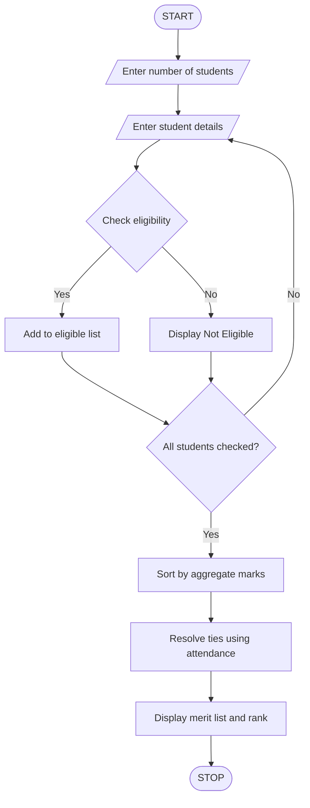

# University Scholarship Allocation – Python Program

## 1. Problem Statement

Develop a Python program to allocate scholarships to students based on their academic performance and eligibility criteria. The program should accept student details such as name, aggregate marks, subject-wise marks, attendance percentage, and annual family income.

The system checks whether students meet the minimum requirements:

- Aggregate marks must be at least 75%.
- Each subject mark must be at least 50.
- Attendance must be at least 75%.
- Annual family income must not exceed ₹2,50,000.

Eligible students are ranked based on aggregate marks. If two students have equal aggregate marks, attendance is used to resolve the tie. The program displays the eligible students in merit order.

## 2. Algorithm

1. Start the program.
2. Read the number of students.
3. Enter each student's name.
4. Read aggregate marks.
5. Read marks in three subjects.
6. Read attendance percentage.
7. Read annual family income.
8. Check all eligibility conditions.
9. If all conditions are satisfied, add the student to the eligible list.
10. Sort eligible students by aggregate marks in descending order.
11. If aggregate marks are equal, rank by attendance.
12. Display the eligible students and their ranks.
13. Stop the program.

## 3. Flowchart




## 5. Sample Input

```
Enter number of students: 3

Enter Student 1 Details
Enter name: Anu
Enter aggregate marks: 90
Enter marks in 3 subjects:
Subject 1: 85
Subject 2: 90
Subject 3: 88
Enter attendance: 92
Enter annual family income: 180000

Enter Student 2 Details
Enter name: Ravi
Enter aggregate marks: 85
Enter marks in 3 subjects:
Subject 1: 70
Subject 2: 75
Subject 3: 80
Enter attendance: 95
Enter annual family income: 200000

Enter Student 3 Details
Enter name: Sita
Enter aggregate marks: 70
Enter marks in 3 subjects:
Subject 1: 80
Subject 2: 75
Subject 3: 70
Enter attendance: 80
Enter annual family income: 300000
```

## 6. Sample Output

```
Student is Eligible

Student is Eligible

Student is Not Eligible

--- SCHOLARSHIP MERIT LIST ---

Rank: 1
Name: Anu
Aggregate Marks: 90.0
Attendance: 92.0
Scholarship: Approved
----------------------

Rank: 2
Name: Ravi
Aggregate Marks: 85.0
Attendance: 95.0
Scholarship: Approved
----------------------

